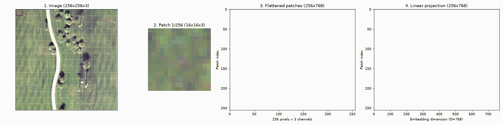

# Vision Transformer (ViT) Paper Implementation

From-scratch PyTorch implementation of the Vision Transformer from [An Image is Worth 16x16 Words: Transformers for Image Recognition at Scale](https://arxiv.org/abs/2010.11929) (Dosovitskiy et al., 2020), built step by step in notebooks using only basic PyTorch layers.

<p align="center">
  
</p>

## Table of Contents

- [About](#about)
- [Progress](#progress)
- [Setup](#setup)
  - [Environment](#environment)
  - [Data](#data)
- [Usage](#usage)
- [Implementation](#implementation)
  - [Patch embedding](#patch-embedding)
- [Citation](#citation)

## About

The goal of this repository is to understand the Vision Transformer by rebuilding it piece by piece, mapping each part of the code back to the equations in the paper. Every component is implemented and explained in its own notebook, without relying on `torchvision`'s or `timm`'s ready-made ViT modules.

## Progress

- ✅ Image patching
- ✅ Linear patch projection
- ✅ Class token
- ✅ Learnable position embedding
- ⬜ Multi-head self-attention
- ⬜ MLP block
- ⬜ Transformer encoder
- ⬜ Classification head
- ⬜ Training and evaluation

## Setup

### Environment

The project uses [uv](https://docs.astral.sh/uv/) and Python 3.14.

```bash
git clone git@github.com:zvonimirkonjevic/vit-pytorch.git
cd vit-pytorch
uv sync
```

Open the notebooks in Jupyter or VS Code and select the `.venv` interpreter as the kernel.

### Data

The notebooks use the [UC Merced Land Use dataset](http://weegee.vision.ucmerced.edu/datasets/landuse.html): 2,100 aerial RGB images of roughly 256x256 pixels (44 are a few pixels off), split evenly across 21 land-use classes. Download it and place the class folders under `data/raw/`:

```
data/
└── raw/
    ├── agricultural/
    │   ├── agricultural00.tif
    │   └── ...
    ├── airplane/
    └── ...
```

`data/` is git-ignored.

## Usage

| Notebook | Description |
| --- | --- |
| [`02_embedding_patches.ipynb`](notebooks/02_embedding_patches.ipynb) | Splits images into patches, flattens them, projects them to $D$ dimensions, and prepends the class token and adds position embeddings. Also generates the GIF above. |

## Implementation

### Patch embedding

The transformer expects a 1D sequence of token embeddings, so an image $\mathbf{x} \in \mathbb{R}^{H \times W \times C}$ is reshaped into a sequence of $N = HW / P^2$ flattened patches $\mathbf{x}_p \in \mathbb{R}^{N \times (P^2 \cdot C)}$. Eq. 1 of the paper then builds the input sequence:

$$
\mathbf{z}_0 = [\mathbf{x}_\text{class};\, \mathbf{x}^1_p \mathbf{E};\, \mathbf{x}^2_p \mathbf{E};\, \cdots;\, \mathbf{x}^N_p \mathbf{E}] + \mathbf{E}_{pos}, \quad \mathbf{E} \in \mathbb{R}^{(P^2 \cdot C) \times D}, \quad \mathbf{E}_{pos} \in \mathbb{R}^{(N+1) \times D}
$$

| Paper | Code (`PatchEmbedding`) | Shape for a 256x256 RGB image, $P = 16$, $D = 768$ |
| --- | --- | --- |
| $\mathbf{x}$ | `images` | `(B, 3, 256, 256)` |
| $\mathbf{x}_p$ | `patchify(images)` | `(B, 256, 768)` |
| $\mathbf{x}_p \mathbf{E}$ | `linear(...)` | `(B, 256, 768)` |
| $\mathbf{x}_\text{class}$ | `class_token` | `(1, 1, 768)` |
| $\mathbf{E}_{pos}$ | `position_embedding` | `(1, 257, 768)` |
| $\mathbf{z}_0$ | `forward(images)` | `(B, 257, 768)` |

`patchify` avoids Python loops by reshaping the image into a grid of patches and permuting the axes so each patch becomes one contiguous block.

## Citation

```bibtex
@inproceedings{dosovitskiy2021image,
  author     = {Dosovitskiy, Alexey and Beyer, Lucas and Kolesnikov, Alexander and Weissenborn, Dirk and Zhai, Xiaohua and Unterthiner, Thomas and Dehghani, Mostafa and Minderer, Matthias and Heigold, Georg and Gelly, Sylvain and Uszkoreit, Jakob and Houlsby, Neil},
  title      = {An Image is Worth 16x16 Words: Transformers for Image Recognition at Scale},
  booktitle  = {International Conference on Learning Representations},
  eventtitle = {ICLR 2021},
  date       = {2021},
  eprint     = {2010.11929},
  eprinttype = {arxiv},
  url        = {https://openreview.net/forum?id=YicbFdNTTy}
}
```
